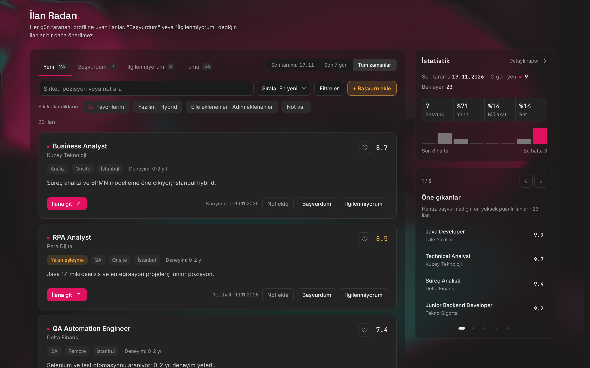
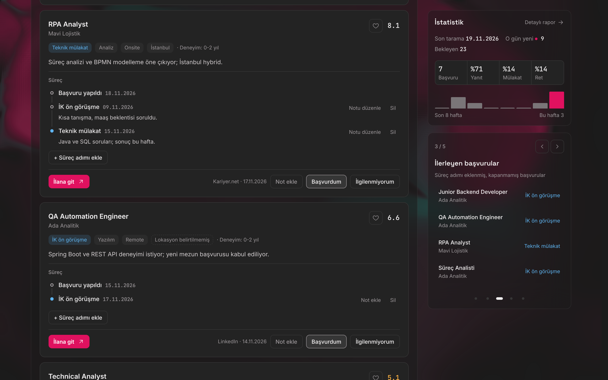
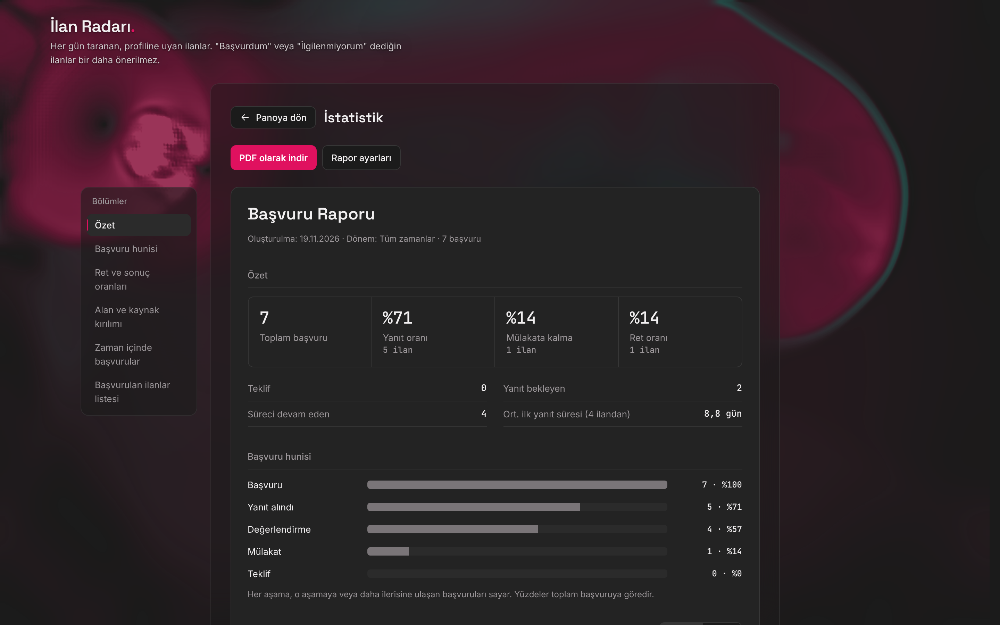
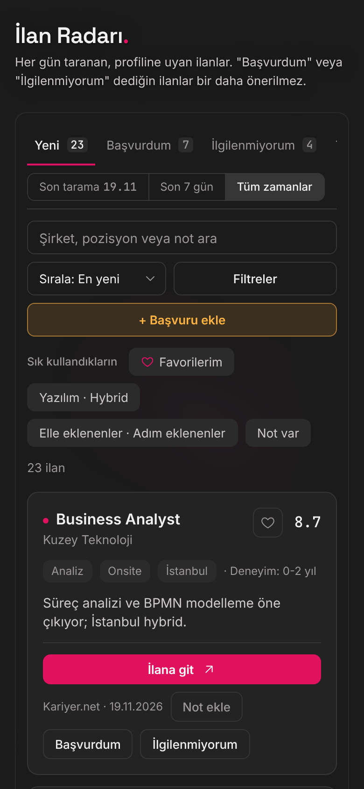

# İlan Radarı

Günlük taramayla bulunan iş ilanlarını tek sayfada toplayan, başvuru sürecini takip eden ve başvuru istatistiklerini raporlayan kişisel bir pano. Sayfa bir [claude.ai](https://claude.ai) artifact'i olarak çalışır.



## Özellikler

- **Pano:** Solda ilan paneli; sağda istatistik önizlemesi ve slayt alanı (öne çıkanlar, favoriler, ilerleyen başvurular, yanıt bekleyenler). Slayttaki bir ilana dokununca listede o karta gidilir.
- **Varsayılan görünüm:** Yeni sekmesi, tüm zamanlar. Zaman "Son tarama" veya "Son 7 gün" ile daraltılabilir; her sekme kendi seçimini sayfa açık kaldığı sürece hatırlar. Liste boşsa altında başvurulmamış favoriler, onlar da yoksa ilerleyen başvurular gösterilir.
- **Sık kullanılan filtreler:** Birlikte kullandığın filtre kombinasyonları kaydedilir; en sık kullanılanlar arama satırının altında tek dokunuşla uygulanan öneriler olarak çıkar. "Favorilerim" her zaman en başta durur.
- **İlan listesi:** Her ilan eşleşme puanı, alan, çalışma şekli, lokasyon ve neden eşleştiğini anlatan kısa bir açıklamayla gelir.
- **Durum sekmeleri:** Yeni, Başvurdum, İlgilenmiyorum ve Tümü. "Başvurdum" veya "İlgilenmiyorum" olarak işaretlenen ilan bir daha önerilmez.
- **Arama, sıralama ve filtreler:** Şirket, pozisyon veya not içinde arama; tarihe ya da puana göre sıralama; favori, not, alan, çalışma şekli, lokasyon, kaynak ve eşleşme düzeyine göre filtreleme.
- **Notlar ve favoriler:** Her ilana not yazılabilir ve ilan favorilere eklenebilir.
- **Süreç takibi:** Başvurulan ilanlara İK ön görüşme, online test, teknik mülakat, teklif, olumsuz sonuç gibi adımlar tarihleriyle eklenir.
- **Elle başvuru ekleme:** Taramanın bulmadığı bir ilana yapılan başvuru elle kaydedilebilir.
- **İstatistik ve rapor:** Özet, başvuru hunisi, ret ve sonuç oranları, alan ve kaynak kırılımı, haftalık başvuru grafiği ve başvuru listesi. Rapor döneme, alana ve kaynağa göre süzülür ve PDF olarak indirilir.
- **Akışkan arka plan:** Sayfanın tamamının arkasında imleci izleyen, boşta kendi kendine gezinen bir WebGL akışkan simülasyonu; pembe akışın kenarlarında hafif turkuaz vurgular.

## Ekran görüntüleri

Görüntüler uydurma örnek veriyle alındı; gerçek başvuru verisi içermez.

**Başvurular ve süreç takibi**



**Detaylı istatistik**



**Telefon**



## Nasıl çalışır

Sayfanın tamamı tek dosyadır: [`ilan-radari.html`](ilan-radari.html). Derleme adımı ve bağımlılık kurulumu yoktur.

- **Veri:** İlanlar ve başvurular dosyada değil, artifact'in kendi veritabanında durur (`jobs` ve `runs` koleksiyonları). Bu repoda yalnızca sayfanın kodu vardır; kişisel başvuru verisi yoktur.
- **Tarama:** İlanları günlük bir tarama bulur ve veritabanına yazar. Sayfa veritabanını canlı dinler, yeni ilanlar yenilemeye gerek kalmadan listeye düşer.
- **PDF:** Rapor tarayıcıda `html2canvas` ve `jsPDF` ile üretilir; bu iki kütüphane yalnızca indirme sırasında cdnjs'ten yüklenir.
- **Arka plan:** Ek kütüphane kullanmayan, WebGL2 üzerinde yazılmış bir akışkan simülasyonu. "Hareketi azalt" ayarı açıkken veya WebGL2 yokken gizlenir.

## Çalıştırma

Dosya bir claude.ai artifact'i olarak yayınlanmak üzere yazılmıştır ve bu yüzden `<html>`, `<head>`, `<body>` etiketlerini içermez; bunları artifact ortamı ekler.

Dosyayı tarayıcıda doğrudan açarsan arayüz görünür ama veri gelmez, çünkü veritabanına yalnızca claude.ai içinde erişilebilir. Bu durumda sayfa "Kayıtlara ulaşılamıyor" mesajını gösterir.

## Test

`tests/` klasöründeki karşılaştırma testi, çalışma kopyasındaki sayfayı bir git sürümüyle karşılaştırır. Davranışı değiştirmemesi gereken düzenlemelerden sonra çalıştırılır:

```
node tests/check.js          # son commit ile karşılaştırır
node tests/check.js <sürüm>  # belirli bir sürümle karşılaştırır
```

Her iki sürüm de sahte veritabanı ve sabit tarihle headless Chrome'da açılır, 113 senaryo 375, 900 ve 1400 piksel genişlikte çalışır. Her senaryoda sayfanın HTML'i, tarayıcıda saklananlar ve veritabanı yazımları; seçili senaryolarda görünen her öğenin hesaplanmış stili (üzerine gelme, klavye odağı ve basılı durumlar dahil) karşılaştırılır. Fark yoksa `AYNI` yazar. Node.js ve Google Chrome gerekir; Chrome başka bir yerdeyse yolu `CHROME` ortam değişkeniyle verilir. Akışkan arka plan ve PDF indirme testin kapsamı dışındadır.

## Sürüm geçmişi

Commit geçmişi artifact'in 17. sürümünden başlar; daha önceki sürümler artifact'ten geri alınamadı.
